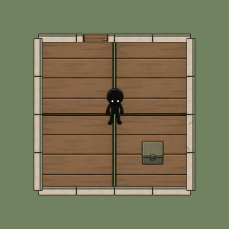

# Cohesive construction art

`source.png` is original AI-generated artwork: four columns (plain timber floor, cream/slate wall strip, timber doorway, olive storage chest), each with intact, damaged and breached states. The measured source-cell windows are recorded in the importer because generation did not yield a uniform grid. There is no roof in this construction set.

`packages/art-tools/import-construction.ts` crops and packs 12 source sprites into centered 128×128 runtime PNGs. Wall and door strips occupy a 128×32 band inside that canvas. Code only performs technical crop/scale/packing, not illustration. The runtime manifest records the source cell and crop.

Floors render at 128×128. Walls/doors render as 64×16 strips, automatically turning 90 degrees on vertical floor grid lines. Storage renders at 40×40 within a floor cell. Preview, saved rotation, rendering, collision, line of sight and occupancy use shared placement geometry. End joints are allowed so perpendicular segments form corners. Adjacent floor tiles can meet without overlapping. Build guides show the selected floor and placement footprint; insufficient wood prevents a valid preview.

Roofs are removed from the build menu and scene; old roof records remain stored. Legacy structures retain their positions. Newly placed walls/doors snap to outer or interior floor grid lines. The owned floor under the pointer is picked automatically, and segment ends clamp inside the floor at corners.

The source sheet, runtime cutouts and an assembled room were inspected. The assembly is a technical composition of runtime sprites, not a browser screenshot. Browser/mobile visual playtesting remains unverified.

