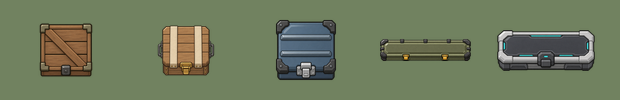

# Five AI loot-crate sprites

These are **lootable world caches only**. Player-crafted storage remains the existing empty storage piece.

| Tier | Sprite             | Shape                                           | Rewards                                                    |
| ---- | ------------------ | ----------------------------------------------- | ---------------------------------------------------------- |
| 1    | Small wooden crate | Compact square, diagonal wooden brace           | Up to 1 roll of basic salvage/supplies                     |
| 2    | Supply crate       | Strapped timber, cream canvas                   | Up to 2 rolls of supplies/building materials               |
| 3    | Reinforced crate   | Slate-blue steel, reinforcement ribs            | Up to 3 rolls, including electronics, steel and ammunition |
| 4    | Military cache     | Long skinny olive case with yellow clasps       | Up to 4 rolls from a better pool with a chance of a pistol |
| 5    | Advanced cache     | Long thick graphite/steel case with cyan insets | Up to 5 rolls; a pistol is the first reward when it fits   |

All five are original AI-generated artwork with true transparency. The two long cases were edited with the image-generation tool to change their shapes. Unmodified final source PNGs are in `sources/`. `packages/art-tools/import-loot-crates.ts` only crops alpha bounds, scales without stretching and packs transparent padding. Runtime metadata preserves the source crop and proportions.

The existing six scavenging locations now use tiers 1, 2, 3, 4, 3 and 5 in their original index order. Higher tiers improve average reward value and available rolls; rolls are limited by backpack capacity. Full stacks and duplicate weapons are skipped. Searching requires proximity and retains the existing per-player 60-second cooldown, persisted across reconnects/restarts. A completely full backpack does not consume the cooldown.

Searchable crates have tier-colored outlines, tier labels, an in-range search prompt, and map markers. Depleted crates dim and display an EMPTY countdown. Scenery has none of these indicators. Public loot bags have a gold outline and LOOT BAG label.

`preview.png` is a technical composition of the runtime sprites at game scale, not a browser screenshot. Source art, transparency, proportions and the scale preview were inspected; interactive browser/mobile rendering remains unverified.

