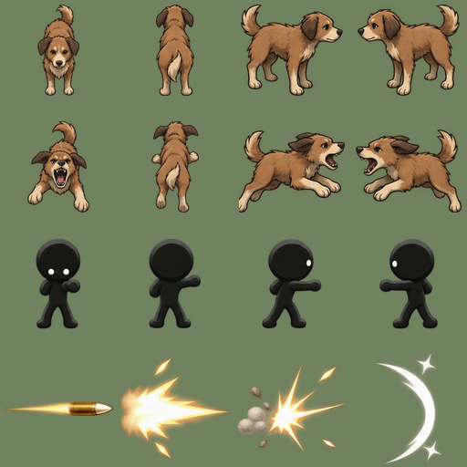

# Stray dogs and combat effects

All source artwork is AI generated:

- `dog-base.png`: four directional rows, eight columns per row: idle, bite anticipation, lunge, bite snap, recovery, hurt, defeated, idle recovery.
- `dog-walk.png`: eight trot source cells in each of the four directional rows.
- `bullet-effects.png`: 2×2 atlas of a right-facing bullet/tracer, right-facing muzzle flash, bullet impact and bite-contact arc.
- The matching unarmed punch source is `../characters/stick-punch.png` (eight columns × four directions).

`packages/art-tools/import-wildlife.ts` performs technical crops, normalization and packing only. It creates four 128px-cell dog atlases with idle/walk/run/attack/hurt/death rows and four transparent effect PNGs. Run reuses the trot cells at a faster rate; bite uses four source phases held across eight runtime cells. Idle/hurt/death hold one pose. No extra animation drawings are claimed for held cells.

The server owns wildlife movement, targeting, bite timing, damage, defeat and respawn. Client sprites never decide damage. Pistol damage remains hitscan; the bullet sprite is a visible tracer of a server-confirmed hit. Source files retain their original pixels. `preview.png` is a technical composition of runtime dog, punch and VFX cells, not a game screenshot. Source/packed art, alpha, dimensions and framing were inspected; browser/mobile visual playtesting remains unverified.

